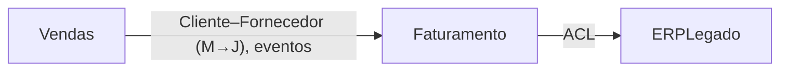

# Mapeamento de Contextos Delimitados

Um mapa de contextos mostra onde cada modelo é válido e como os modelos conversam entre si. A maior parte da dor de integração vem de relações que ninguém nomeou: um time se conformando em silêncio ao modelo de outro, ou uma tabela compartilhada que acopla dois contextos.

A saída é um **mapa de contextos e uma tabela de relações**. Ela descreve o estado atual, o estado alvo, ou os dois. Diga qual.

## Convenções

- Termos estratégicos em pt-BR seguidos do en-US: Contexto Delimitado (Bounded Context), Subdomínio (Subdomain), Núcleo (Core), Suporte (Supporting), Genérico (Generic), Mapa de Contextos (Context Map), Montante (Upstream), Jusante (Downstream), Kernel Compartilhado (Shared Kernel), Camada Anticorrupção (Anticorruption Layer), Serviço de Host Aberto (Open Host Service), Linguagem Publicada (Published Language).
- Entradas: contextos candidatos e eventos pivô de `event-storming`; contextos do passo 2 de `domain-modeling`; times e sistemas existentes, do usuário.
- Um contexto é uma fronteira de modelo, não uma unidade de implantação. Pode ser uma pasta ou módulo num monólito (veja `ts-module-layout`).
- Propriedade ou estrutura de times desconhecida vai para **Perguntas em aberto**.

## Processo

### 1. Encontrar os contextos
Sinais de fronteira: a mesma palavra significa coisas diferentes ("Cliente" em Vendas vs. Faturamento); regras diferentes para o mesmo conceito; um evento pivô onde a propriedade muda; um time ou sistema externo diferente. Nomeie cada contexto pela capacidade de negócio, não por uma tecnologia.

### 2. Classificar os subdomínios
- **Núcleo**: onde o negócio compete. Construa, com as melhores pessoas e o modelo mais rico.
- **Suporte**: necessário e específico, mas não diferencia. Construa de forma simples.
- **Genérico**: problemas resolvidos (autenticação, pagamentos, e-mail). Compre ou use uma biblioteca.

### 3. Mapear cada relação
Para cada par de contextos que trocam dados ou chamadas, declare a direção (**montante** influencia, **jusante** depende) e o padrão:

| Padrão | Significado | Use quando |
|---|---|---|
| Parceria (Partnership) | Dois times têm sucesso ou fracassam juntos; coordenam as mudanças | Objetivos muito ligados, times próximos |
| Kernel Compartilhado (Shared Kernel) | Um modelo/código pequeno que os dois mantêm | Conceitos compartilhados muito estáveis; mantenha-o mínimo |
| Cliente–Fornecedor (Customer–Supplier) | O montante planeja para as necessidades do jusante | O jusante tem voz nas prioridades do montante |
| Conformista (Conformist) | O jusante adota o modelo do montante como ele é | O montante não vai mudar e o modelo dele é aceitável |
| Camada Anticorrupção (ACL) | O jusante traduz o modelo do montante para o seu | O modelo do montante é ruim, legado ou externo; protege o núcleo |
| Serviço de Host Aberto + Linguagem Publicada | O montante oferece um protocolo estável e um esquema documentado para muitos consumidores | Muitos jusantes; APIs públicas ou de plataforma |
| Caminhos Separados (Separate Ways) | Sem integração; duplica-se em vez disso | Integrar custa mais do que retorna |

Domínios de núcleo que consomem sistemas externos ou legados quase sempre devem usar uma Camada Anticorrupção.

### 4. Escolher o estilo de integração
Chamada síncrona (API), eventos de domínio assíncronos ou banco compartilhado. Um banco compartilhado entre contextos é um Kernel Compartilhado escondido. Nomeie-o e planeje a saída.

### 5. Sinalizar os problemas
Relações a corrigir no estado alvo: a grande bola de lama, um kernel compartilhado que não para de crescer, um núcleo conformista, dependências cíclicas entre contextos.

## Formato

~~~
## Contextos
| Contexto | Subdomínio (núcleo/suporte/genérico) | Responsabilidade | Termos-chave | Dono (time) |

## Mapa de contextos

## Relações
| Montante | Jusante | Padrão | Integração (API/eventos/BD) | Tradução | Notas |

## Problemas e estado alvo
## Perguntas em aberto
~~~

## Próximo

- `domain-modeling` por contexto.
- `ts-module-layout`: uma pasta de primeiro nível (ou módulo NestJS) por contexto.
- `api-design`: Serviços de Host Aberto e eventos publicados viram contratos.
- `architecture-decision-record` para escolhas de relação caras de reverter.

## No Forja

No Forja, o mapa de contextos fica em `memory/20-architecture/context-map.md`, e cada contexto ganha sua pasta em `memory/30-domains/<contexto>/`. Relações caras de reverter viram ADR (`architecture-decision-record`).

## Evite

- Um contexto por entidade ou por tabela.
- Contextos com nome de camada técnica ("Banco de Dados", "Frontend").
- Tratar contextos como microsserviços por padrão.
- Um Kernel Compartilhado que não para de crescer.
- Setas sem padrão e sem direção.
- Inventar estruturas de times. Pergunte.
